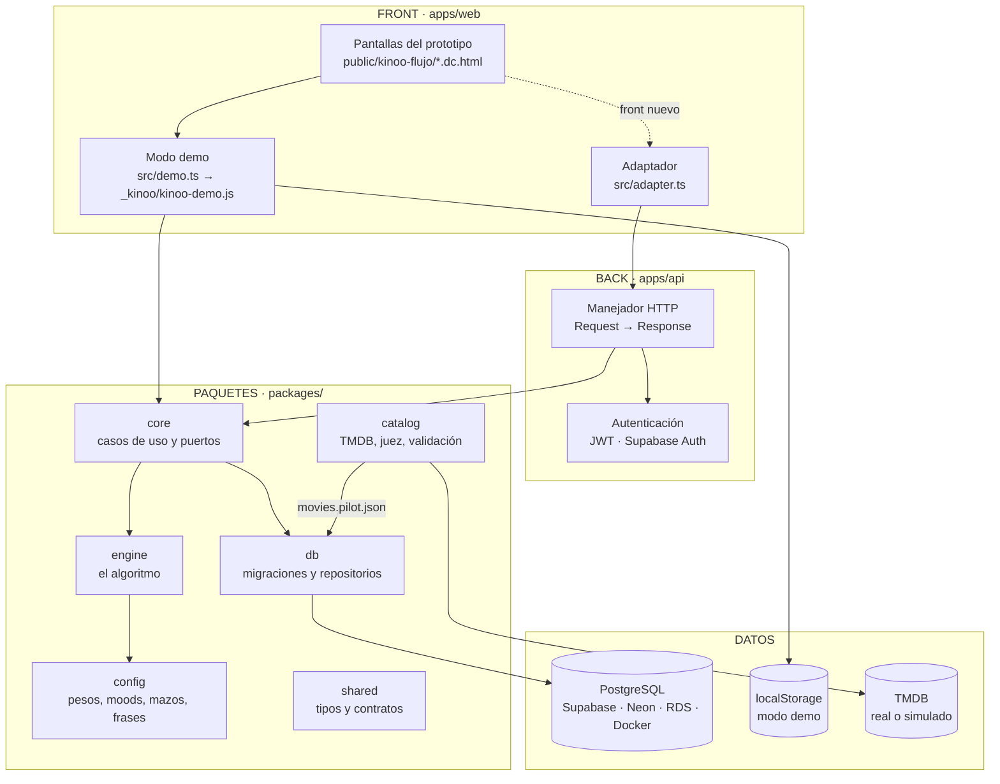

# Arquitectura de Kinoo

**Para qué sirve esto.** Es el mapa del sistema: qué es front, qué es back, qué hace cada paquete y por dónde pasa una recomendación. Si vas a cambiar algo, empieza aquí.

## La idea en una frase

El **motor** (el algoritmo) es una librería pura que no sabe dónde vive. Alrededor hay capas que la conectan con una pantalla, una base de datos o una nube, y cada capa se puede cambiar sin tocar las demás.

## Front y back

| | Carpeta | Qué hay | Corre en |
|---|---|---|---|
| **Front** | `apps/web/` | El prototipo de alta fidelidad (`public/`), el modo demo y el adaptador para hablar con el back (`src/`), pruebas e2e (`e2e/`) | El navegador. Se publica en GitHub Pages |
| **Back** | `apps/api/` | La API HTTP: rutas, autenticación, servidor Node y entrada para Supabase Edge | Node 22, Deno (Supabase Edge) o cualquier nube con `Request`/`Response` |
| **Compartido** | `packages/` | Motor, casos de uso, base de datos, catálogo, configuración y contratos | Donde los importe el front o el back |
| **Infraestructura** | `infra/` | Docker (PostgreSQL + API) y el proyecto de Supabase (funciones, `config.toml`) | Tu máquina o la nube |

## Los paquetes

| Paquete | Responsabilidad | Depende de | No sabe de |
|---|---|---|---|
| `@kinoo/shared` | Tipos y contratos: átomos, eventos, `CardDTO`, `posterUrl()` | nada | todo lo demás |
| `@kinoo/config` | La configuración editable (JSON) como `EngineConfig` | shared | código del motor |
| `@kinoo/engine` | El algoritmo v2: aprendizaje, puntaje, mazos, Ver, explicaciones | shared | bases de datos, HTTP, archivos |
| `@kinoo/core` | Casos de uso (`KinooService`), puertos (`KinooRepository`) y el ejecutor (`KinooRunner`) | engine, shared | qué base de datos se usa |
| `@kinoo/db` | Migraciones portátiles, aplicador, repositorios `PostgresRepository` y `SupabaseRestRepository` | core | qué nube aloja la base |
| `@kinoo/catalog` | Cliente de TMDB (real o simulado), normalización, cuotas, juez, validación | shared | el motor |
| `@kinoo/api` (`apps/api`) | HTTP, CORS, autenticación | core, db | qué pantalla la llama |
| `@kinoo/web` (`apps/web`) | Pantallas y modo demo | core, engine, config | dónde está la base de datos |

**Regla:** las flechas van hacia adentro. El motor no importa nada de `db`, `api` ni `web`. Por eso corre igual en el navegador, en Node y en Deno.

## Recorrido de una acción

"Ana toca *Quiero verla* en Descubrir":

1. **Front:** la pantalla traduce el gesto a una acción: `saved_intent` con `movie_id`, `flipped`, `deck_id` y `slot`. El back nunca conoce el gesto.
2. **Transporte:** en modo demo, `KinooDemo.onCard()`; con back, `POST /events` (ver `guias/contrato-api.md`).
3. **Back:** `createKinooHandler` valida la sesión y pide a `KinooRunner` que ejecute el caso de uso.
4. **Núcleo:** `KinooRunner` carga la foto de Ana (sus eventos y su mazo abierto) desde el repositorio. `KinooService.postEvents()` valida el evento, decide si es *match especial* y lo aplica al modelo.
5. **Motor:** `applyEvent()` mueve el perfil y la receta del mood (sección 7 de la especificación).
6. **Guardado:** primero el evento (fuente de verdad), después el mazo y lo derivado (perfil, recetas, marcas).
7. **Respuesta:** `{ accepted, results: [{ save: { special_match } }] }`. El front decide cómo mostrarlo.

## Dónde puede vivir la base de datos

Las migraciones (`packages/db/migrations`) son PostgreSQL estándar. Lo único que cambia entre nubes es **quién es la persona actual**, y eso lo define un archivo de proveedor:

| Proveedor | Archivo | Persona actual | Cómo se conecta el back |
|---|---|---|---|
| Supabase | `providers/supabase.sql` | `auth.uid()` del JWT de Supabase Auth | Edge Functions con `SupabaseRestRepository`, o servidor Node con conexión directa |
| PostgreSQL genérico (Neon, RDS, Cloud SQL, Docker…) | `providers/postgres.sql` | `app.user_id` que pone el servidor en cada transacción | Servidor Node (`apps/api/src/server.node.ts`) con `PostgresRepository` |

Las pruebas corren las mismas migraciones y las mismas reglas de seguridad (RLS) con los dos proveedores. Detalle en `guias/base-de-datos.md` y `guias/despliegue.md`.

## Decisiones de arquitectura

| ADR | Tema |
|---|---|
| [0001](adr/0001-estructura.md) | En qué repositorio se construye |
| [0002](adr/0002-monorepo.md) | Monorepo con workspaces |
| [0003](adr/0003-api-y-modo-demo.md) | Un solo servicio para la API y el modo demo |
| [0004](adr/0004-front-back-y-nube.md) | Front y back separados, base de datos portátil y simulación de TMDB |

## Ejemplo con números

Una petición `POST /events` con un `saved_intent` en el servidor Node:

- 1 transacción para leer: los eventos de la persona (por ejemplo, 120 filas) y su mazo abierto.
- El motor recalcula su perfil desde los 120 eventos en menos de 5 ms (21 átomos × 120 eventos).
- 1 transacción para escribir: 1 evento nuevo, el mazo (si cambió) y 3 tablas derivadas.
- El catálogo (61 películas) y la configuración se leen una vez y quedan en caché 5 minutos.
