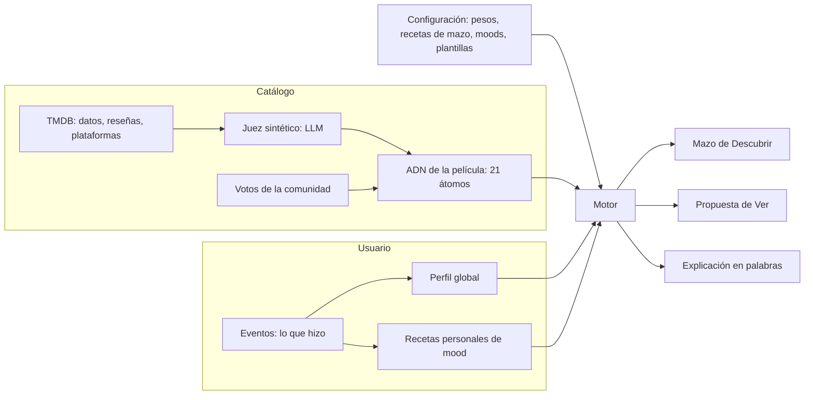

# Kinoo · Algoritmo de recomendación v2

**Versión:** 2.0 · 4 de noviembre de 2026
**Reemplaza a:** *Kinoo — Documento Madre: Arquitectura del Algoritmo, Perfilamiento y Explicabilidad (v1.0)*, escrito con el modelo Argon. Ese documento queda en `docs/historico/` como referencia.
**Para quién es:** para el equipo de Karuk y para el modelo que construye el back. La sección 0 está escrita para que cualquier persona del equipo la entienda sin saber programar.

Niveles de certeza, como en los demás documentos de Kinoo:

- **Decidido:** lo acordó Camilo.
- **Propuesto:** lo propone esta especificación; se valida en la construcción.
- **Supuesto:** número inicial para poder construir. Vive en configuración y se ajusta con datos.

---

## 0. El algoritmo en palabras simples

Kinoo describe cada película con **21 rasgos** (¿es lenta?, ¿es melancólica?, ¿tiene una estética cálida?). Esos rasgos son iguales para todos: son los **átomos**.

Cada persona tiene un **perfil** con esos mismos 21 rasgos. El perfil dice cuánto le responde cada rasgo cuando una película lo tiene. Empieza con unas preguntas en el onboarding y se ajusta con todo lo que hace: guardar, descartar, ver y contar qué tal le pareció.

Los moods poéticos ("Llorar bonito", "Apagar el cerebro") son **moléculas**: recetas que combinan átomos. Todos empiezan con la misma receta, pero **cada persona tiene su propia copia**, que se ajusta con lo que hace dentro de ese mood. Así, "Llorar bonito" de Ana termina pidiendo dramas lentos y cálidos, y el de Leo termina pidiendo comedias familiares que emocionan.

Para recomendar, Kinoo compara el perfil (y el mood elegido, si hay uno) con los rasgos de cada película. Para explicar, mira qué rasgos aportaron más a esa coincidencia y los dice en palabras, nunca con porcentajes.

Tres reglas de construcción hacen que todo esto aguante cambios en el front:

1. **El back guarda lo que la persona hizo, no cómo lo hizo.** No sabe de swipes ni de flechas; sabe que alguien "guardó con intención" o "descartó".
2. **Todo lo que se ajusta vive en tablas, no en código.** Pesos, tamaño del mazo, moods, plantillas de frases.
3. **El perfil es un cálculo, no un dato sagrado.** Se puede recalcular desde el historial si cambia la fórmula.

---

## 1. Qué cambia respecto a v1

| Tema | v1 (Argon) | v2 | Por qué |
|---|---|---|---|
| Átomos | "16" (en realidad 21) + formato | 21 átomos que describen solo la película | Corregir el conteo y separar niveles |
| Dimensión Sensación | `para_llorar`, `dominguera`, `epica`… como átomos | Sale de los átomos. Se reemplaza por **Carga** (carga emocional, complejidad, humor, intimidad, escala épica). Lo poético pasa a moléculas | **Decidido.** "Dominguera" es una ocasión, no una propiedad de la película |
| Aprendizaje | `U += α·γ·(M − 0,5)` con clamp | Promedio móvil exponencial que solo aprende de los rasgos que la película **sí tiene** | v1 aprendía de las ausencias (descartar una película frenética subía "contemplativa") y se saturaba en ±1 |
| Puntaje | Producto punto | Similitud coseno sobre rasgos **por encima del promedio del catálogo** | v1 premiaba películas "intensas en todo" |
| Fuente de verdad | Tabla de marcas, una fila por película | Registro de **eventos** que solo se agrega; las marcas se derivan | No se pierde historia; se puede recalcular |
| Gestos | Swipe ↑ = "ya la vi" en la tabla de pesos | El back recibe acciones; el gesto lo decide el front | **Decidido.** La flecha ↑ falló en la prueba de octubre |
| Moods | Recetas en el documento | Catálogo de moods en una tabla editable, con definición de una frase | El acierto de moods fue 48 % en la prueba |
| Mazo | 6/2/1/1 fijo | Receta de mazo en configuración; tamaño 5, 10 o 20 | La prueba pidió control de cantidad (0 de 16 lo encontró) |
| Cartas de creador | Obligatorias | Si no hay curador, se usa el mazo del equipo y luego una afín | Comunidad aún no existe |
| Corrección comunitaria | Sobrescribir el átomo | Votos aparte que se combinan con lo que dijo el LLM | No se pierde la etiqueta original |
| Frente de la carta | Ciego por diseño | El back entrega las dos caras; el front decide cuál mostrar | La card B propuesta pone el póster primero |

---

## 2. Principios

Se mantienen los cinco de v1, con un ajuste:

1. **Explicar sin números.** Nunca se muestra un porcentaje de afinidad. El cálculo existe, pero el usuario ve razones en palabras.
2. **Intención separada de historial.** Guardar porque quieres verla (○), haberla visto (●) y querer repetirla (◉) son estados distintos.
3. **Átomos fijos, moléculas personales.**
4. **El momento importa.** El perfil se combina con el contexto: el mood o sobre elegido en Descubrir, los filtros de Ver.
5. **Experiencia, no gamificación.** Mazos finitos, sin rachas ni puntajes.

Y se añaden tres de ingeniería:

6. **Eventos como fuente de verdad.**
7. **Configuración en datos.**
8. **El back no conoce pantallas ni gestos.** Habla de acciones, películas, mazos y moods.

---

## 3. Cómo encajan las piezas



---

## 4. Capa 1: los átomos

Cada película recibe un valor entre 0,0 y 1,0 en cada átomo. Los átomos son independientes: una película puede ser a la vez melancólica y luminosa.

| Dimensión | Átomo (clave) | Etiqueta para explicar | Qué mide |
|---|---|---|---|
| **Dinámica** | `frenetica` | frenéticas | Cortes rápidos, acción constante |
| | `agil` | ágiles | Avanza rápido sin agobiar |
| | `pausada` | a fuego lento | Se toma su tiempo, pero avanza |
| | `contemplativa` | contemplativas | Planos largos, poca trama |
| **Atmósfera** | `reconfortante` | reconfortantes | Te deja bien |
| | `luminosa` | luminosas | Optimista, cálida en el ánimo |
| | `melancolica` | melancólicas | Tristeza suave, nostalgia |
| | `tensa` | tensas | Suspenso, nervios |
| | `inquietante` | inquietantes | Incomodidad, extrañeza |
| | `sombria` | sombrías | Oscura, dura |
| **Estética** | `cruda` | de estética cruda | Realista, cámara en mano |
| | `onirica` | oníricas | Surreal, de sueño |
| | `neon` | de neón | Colores saturados, nocturna |
| | `pastel` | de tonos pastel | Suave, composiciones cuidadas |
| | `calida` | de luz cálida | Paleta cálida, textura de película |
| | `monocromatica` | en blanco y negro o casi | Paleta reducida |
| **Carga** | `carga_emocional` | que mueven por dentro | Cuánto te puede hacer llorar o conmover |
| | `complejidad` | que exigen atención | Trama enredada, te hace pensar |
| | `humor` | con humor | Cuánto te hace reír |
| | `intimidad` | íntimas | Pocos personajes, escala personal |
| | `escala_epica` | épicas | Gran escala, aventura, espectáculo |

La lista vive en la tabla `atoms` (clave, dimensión, etiqueta, descripción, orden). **Supuesto:** si en el futuro se agrega un átomo, se agrega una fila y se re-etiqueta el catálogo; el perfil de los usuarios se recalcula desde los eventos.

**Datos que no son gusto.** Duración, año, géneros de TMDB, idioma, país, director y plataformas por país se guardan aparte. Sirven para **filtrar** ("menos de 1 h 45", "solo lo que hay en mis plataformas") y para diversidad, no para el perfil.

**Series.** Fuera del alcance del piloto. El formato (miniserie, antología…) será metadato, no átomo.

### 4.1 Rasgo distintivo

Para comparar, no se usa el valor crudo del átomo, sino **cuánto sobresale ese rasgo frente al promedio del catálogo**:

```
m̂ᵢ = clamp( (Mᵢ − μᵢ) / (1 − μᵢ), 0, 1 )
```

- `Mᵢ`: valor del átomo en la película.
- `μᵢ`: promedio de ese átomo en todo el catálogo (se recalcula cuando cambia el catálogo).
- Si una película tiene `calida = 0,85` y el promedio del catálogo es `0,40`, su rasgo distintivo es `(0,85 − 0,40) / 0,60 = 0,75`.

Así, un rasgo que casi todas las películas tienen no domina las recomendaciones, y lo que la película **no** tiene vale 0 (no se aprende de ausencias).

---

## 5. Capa 2: las moléculas (moods)

Un mood es una receta: un peso por átomo, entre −1 y +1. Los pesos negativos expresan lo que el mood evita.

**Ejemplo de receta semilla, "Llorar bonito":**

| Átomo | Peso |
|---|---|
| `carga_emocional` | +0,9 |
| `melancolica` | +0,6 |
| `reconfortante` | +0,4 |
| `intimidad` | +0,4 |
| `sombria` | −0,5 |
| `frenetica` | −0,4 |

**Cómo se vuelve personal (propuesto).** La primera vez que alguien usa un mood, se copia la receta semilla a su receta personal. Después, cada evento que ocurre dentro de ese mood (por ejemplo, guardar una carta de un sobre de "Llorar bonito") ajusta **solo esa receta** con la misma regla del perfil (sección 7). La semilla nunca se modifica, así que siempre se puede volver a ella.

- Ana guarda dramas lentos y de luz cálida dentro de "Llorar bonito" → su receta sube `pausada` y `calida`.
- Leo guarda comedias familiares emotivas → su receta sube `humor` y `luminosa`.
- El mismo sobre le da a cada uno un mazo distinto, y la explicación lo dice: *"Responde a tu forma de llorar bonito: lenta y de luz cálida."*

**Catálogo de moods.** Vive en la tabla `vibes`: clave, nombre visible, **definición en una frase** (requisito de la prueba de octubre), receta semilla, películas de ejemplo, activo o no, versión.

**Películas de ejemplo.** Las calcula el motor (las de mayor puntaje para la receta semilla) y el equipo puede fijarlas a mano. Así se evita el caso de *Entre navajas* como ejemplo de "Solo reírme" (19 % de acierto).

**Moods iniciales (supuesto, a revisar por el equipo):** se unifican los 7 del carrete de Ver y los 8 de la prueba en una sola lista. "Sufrir bonito" y "Sentir algo" se confundieron en la prueba: el piloto deja solo "Llorar bonito" y marca la fusión como decisión pendiente. "Cine del bueno" no es un estado de ánimo: se implementa como receta neutra con más peso en la calidad (sección 8).

**Moods como sub-perfiles.** Las recetas personales resuelven el problema del usuario que el viernes quiere neón y el domingo blanco y negro: su perfil global no tiene que promediar ambos, porque cada momento llega con su mood.

---

## 6. Eventos: lo que la persona hace

El back recibe **acciones**, no gestos. Cada evento se guarda en la tabla `events` y nunca se edita.

| Evento | Cuándo ocurre | Datos extra |
|---|---|---|
| `onboarding_choice` | Elige entre dos opciones en los duelos | `chosen_movie_id`, `rejected_movie_id` |
| `deck_opened` | Abre un mazo o sobre | `deck_id`, `vibe` |
| `card_flipped` | Ve el reverso de una carta | `deck_id`, `slot` |
| `saved_intent` | Guarda con intención (○) | `flipped` (sí o no), `vibe`, `deck_id`, `slot` |
| `dismissed` | Dice que no le interesa hoy | `flipped`, `vibe` |
| `marked_seen` | Marca que ya la vio (●) | `flipped`, `reaction` opcional |
| `rewatch_intent` | Quiere repetir una vista (◉) | — |
| `deck_completed` | Termina el mazo | `deck_id` |
| `watch_proposed` | Ver le propone una película | `filters` |
| `watch_skipped` | Pide "otra" en Ver | — |
| `watch_started` | Sale a la plataforma | `provider` |
| `watch_confirmed` | Al volver, confirma que la vio | `reaction`: `loved`, `liked`, `not_for_me`; `rewatch` |
| `attribute_refuted` | Dice que un rasgo no corresponde | `atom` |
| `undo` | Deshace el evento anterior | `undone_event_id` |

Todos los eventos guardan `context` (superficie, mood, filtros, versión del cliente). Con eso se pueden responder preguntas que hoy nadie ha hecho.

**Marcas derivadas.** La tabla `user_movie_state` guarda la marca actual (○, ●, ◉, descartada) y se calcula a partir de los eventos. Es una vista de trabajo, no la fuente de verdad.

### 6.1 Pesos de cada acción (supuesto, en la tabla `action_weights`)

`señal` es la dirección y fuerza (−1 a +1,3). `η` es cuánto mueve el perfil.

| Acción | Señal `w` | Velocidad `η` | Razón |
|---|---|---|---|
| `saved_intent` sin voltear | +0,5 | 0,08 | La premisa sedujo |
| `saved_intent` volteada | +0,4 | 0,08 | Sedujo con todo a la vista |
| `dismissed` | −0,3 | 0,03 | "Hoy no", no un rechazo permanente |
| `marked_seen` sin reacción | +0,2 | 0,03 | Sabemos poco |
| `rewatch_intent` | +1,0 | 0,20 | Afinidad alta |
| `watch_confirmed` · `loved` | +1,0 | 0,25 | **Señal reina:** cumplió fuera de la app |
| `watch_confirmed` · `loved` + `rewatch` | +1,3 | 0,30 | Máximo |
| `watch_confirmed` · `liked` | +0,4 | 0,15 | Cumplió sin deslumbrar |
| `watch_confirmed` · `not_for_me` | −0,8 | 0,25 | Falsa promesa; abre la pregunta de qué rasgo falló |
| `onboarding_choice` | +0,8 elegida / −0,4 rechazada | 0,20 | Arranque en frío |
| `watch_skipped` | 0 | 0 | Señal de momento, no de gusto (se usa en Ver) |

Si el front cambia un gesto, la tabla no cambia. Si el equipo quiere que descartar pese más, cambia una fila.

---

## 7. El perfil del usuario

El perfil global `U` tiene un valor entre −1 y +1 por átomo: **cuánto le responde ese rasgo cuando una película lo tiene.**

### 7.1 Cómo aprende (propuesto)

Para cada evento con señal `w` y velocidad `η`, y para cada átomo en el que la película **sobresale** (`m̂ᵢ > τ`, con `τ = 0,2`):

```
objetivoᵢ = clamp(w · m̂ᵢ, −1, 1)
Uᵢ ← Uᵢ + η · (objetivoᵢ − Uᵢ)
```

En palabras: el perfil se mueve un poco hacia lo que dice el evento, solo en los rasgos que esa película tiene de verdad.

**Ejemplo.** Ana tiene `melancolica = 0,30`. Ve *Past Lives* (rasgo distintivo melancólico 0,90) y dice "Me encantó" (`w = 1,0`, `η = 0,25`). Objetivo: 0,90. Nuevo valor: `0,30 + 0,25 × (0,90 − 0,30) = 0,45`.

Por qué esta regla:

- **Nunca se satura.** Cada valor queda siempre entre −1 y +1 sin necesidad de recortarlo.
- **Lo reciente pesa más.** Cada evento acerca el valor a su objetivo, así que los gustos viejos se van diluyendo solos (responde a la pregunta 1 de v1).
- **No aprende de ausencias.** Descartar una película frenética baja "frenética", pero no sube "contemplativa".
- **Se puede recalcular.** Si cambian los pesos, se vuelve a pasar el historial de eventos.

### 7.2 Confianza

Cada perfil guarda cuántos eventos con señal lleva (`signal_count`). Con pocos eventos, el motor se apoya más en el mood elegido y en la calidad general (sección 8).

### 7.3 Arranque en frío (onboarding)

1. **Plataformas:** elige qué suscripciones tiene. Sin esto, Ver no es accionable.
2. **Duelos "¿Esta o esta?":** entre 5 y 8 pares de películas de rasgos opuestos (por ejemplo, frenética y de neón frente a contemplativa y cálida). El motor elige los pares que más información dan: los que separan los átomos donde el perfil aún está en cero.
3. **La carta de perfil** (sección 7.4) sale del perfil resultante.

### 7.4 La carta de perfil sale del perfil (propuesto)

Cada una de las cinco cartas es un **arquetipo**: una receta en el espacio de átomos (tabla `archetypes`). La carta del usuario es la más parecida a su perfil. Por eso "si mueves estos rasgos, tu carta puede cambiar" pasa a ser literal.

| Arquetipo (nombre propuesto) | Rasgos que lo definen (semilla) |
|---|---|
| El Explorador | `agil`, `humor`, `neon`, `escala_epica` |
| El Observador | `contemplativa`, `complejidad`, `monocromatica` |
| El Romántico | `intimidad`, `calida`, `carga_emocional` |
| El Nocturno | `inquietante`, `onirica`, `sombria` |
| El Luminoso | `luminosa`, `reconfortante`, `pastel` |

**Ajuste del 5 de noviembre de 2026 (Camilo):** ya no son cartas de tarot. La idea es la misma (una carta-arquetipo que sale del perfil), pero la interfaz y los documentos no hablan de tarot. Los nombres de arriba son una propuesta y viven en `data/config/archetypes.json`.

---

## 8. El puntaje

Para una persona `u`, una película `m` y un contexto opcional (un mood `k`):

```
S(u, m) = β · cos(U, m̂) + (1 − β) · cos(R_u,k, m̂) + γ · calidad(m) + bonos
```

| Término | Qué es | Valor inicial (supuesto) |
|---|---|---|
| `cos(U, m̂)` | Parecido entre el perfil y los rasgos distintivos de la película | — |
| `cos(R_u,k, m̂)` | Parecido con la receta personal del mood | — |
| `β` | Cuánto pesa el perfil frente al mood | 0,5 con mood; 1,0 sin mood; 0,3 si `signal_count < 15` |
| `calidad(m)` | Nota de TMDB ajustada por número de votos, de 0 a 1 | — |
| `γ` | Peso de la calidad | 0,10 (0,35 para "Cine del bueno") |
| `bonos` | Frescura en Ver, curadores seguidos | Sección 10 |

Se usa **coseno** para que el puntaje mida parecido de forma, no cantidad de rasgos.

**Candidatos.** Antes de puntuar se excluyen las películas ya guardadas, vistas o descartadas en los últimos 30 días (supuesto) y las que no cumplen los filtros duros.

---

## 9. Descubrir: el armador de mazos

### 9.1 Receta del mazo en configuración

La tabla `deck_recipes` define las posiciones. Receta por defecto (la curva v2 del Sistema de mazos v3):

| Posición | Rol | Regla |
|---|---|---|
| 1 | `afin` | Mayor puntaje |
| 2 | `afin` | |
| 3 | `creador` | |
| 4 | `afin` | |
| 5 | `comodin` | |
| 6 | `afin` | |
| 7 | `creador` | |
| 8 | `sorpresa` | |
| 9 | `afin` | |
| 10 | `afin` | Segundo mayor puntaje (cierre alto) |

**Tamaños 5, 10 y 20 (propuesto).** Hay una receta por tamaño. La de 5 conserva apertura, comodín y cierre; la de 20 repite la curva.

### 9.2 Cómo se llena cada rol

- **Afín:** las de mayor puntaje, con diversidad: nunca dos del mismo director en un mazo y nunca dos películas casi idénticas en rasgos (coseno entre ellas mayor a 0,95).
- **Creador:** una película guardada por un curador que la persona sigue. **Mientras no exista Comunidad:** se toma del mazo curado por el equipo fundador ("Equipo Kinoo"); si tampoco hay, pasa a `afin`.
- **Comodín:** comparte el rasgo favorito de la persona (su átomo con mayor `U` está alto en la película), pero en el resto se parece poco (coseno con el perfil entre 0,1 y 0,4). Refresca sin parecer un error.
- **Sorpresa:** buena calidad (`calidad ≥ 0,75`), puntaje medio o bajo pero no negativo (coseno con el perfil mayor a −0,1), o guardada por tres o más curadores seguidos. Lleva tratamiento visual especial.

### 9.3 Match especial ("Esta es muy tú")

Se activa al guardar una carta si su puntaje está en el 5 % más alto de toda la distribución de esa persona, o si la guardaron tres o más curadores seguidos. Como máximo **una vez por mazo** para que no pierda valor.

### 9.4 Cierre del mazo

Al terminar, el motor compara el perfil antes y después del mazo y elige los dos átomos que más subieron. Con ellos arma "Lo que aprendimos de ti" (por ejemplo, *"Hoy te inclinaste por historias íntimas de luz cálida"*). Devuelve los pósteres de lo guardado para el recibo y el aviso de "Ya sabemos bastante" si la mano tiene tres o más cartas listas para esta noche.

---

## 10. Ver: una propuesta a la vez

1. **Mano:** solo películas con ○ o ◉.
2. **Disponibilidad:** solo las que están en las plataformas del usuario, en su país.
3. **Filtros de momento:** duración, compañía, mood. Si hay mood, se usa su receta personal.
4. **Elección:** mayor puntaje + bono de frescura (+0,10 si se guardó en las últimas 48 horas; +0,15 si fue match especial).
5. **"Otra":** después de tres seguidas, el back responde con la sugerencia de abrir un sobre en Descubrir.
6. **Mano vacía para este momento (responde la pregunta 6 de v1):** se relajan los filtros en este orden: duración, mood. La respuesta dice con honestidad qué se relajó (*"No tienes nada de menos de 90 minutos; esta dura 1 h 52"*). Si nada está en sus plataformas, el back propone un mazo de Descubrir limitado a sus plataformas.

---

## 11. Explicación en palabras

1. Contribución de cada átomo: `cᵢ = Uᵢ × m̂ᵢ` (y, si hay mood, también con la receta personal).
2. Se toman los dos átomos con mayor contribución.
3. Sus etiquetas de la tabla `atoms` se insertan en una plantilla de la tabla `explanation_templates`:
   - *Perfil:* "Encaja con tu gusto por historias {a} y {b}."
   - *Mood personal:* "Responde a tu forma de {mood}: {a} y {b}."
   - *Social (futuro):* "La guardó {curador}, que también disfruta lo {a}."
4. **Regla dura:** la explicación nunca contiene números ni el signo %. Hay una prueba automática que lo verifica.

---

## 12. El catálogo: cómo se perfila cada película

### 12.1 Fuentes

- **TMDB:** datos básicos, póster, sinopsis, palabras clave, reseñas (`/movie/{id}/reviews`, español e inglés) y plataformas por país (`/movie/{id}/watch/providers`, datos de JustWatch).
- **Pendiente legal:** revisar los términos de uso comercial de TMDB y la atribución exigida para los datos de plataformas antes de lanzar. El piloto es una demo académica.

### 12.2 Selección del piloto (300 películas)

- Mezcla de populares y aclamadas, con plataformas en Colombia.
- Cuotas (supuesto): al menos 15 % latinoamericanas, al menos 20 % anteriores al 2000, todos los géneros representados.
- Incluye las películas que usa el prototipo y las del protocolo de pruebas.

### 12.3 El juez sintético

- Un LLM recibe el paquete de TMDB y devuelve JSON con un esquema estricto: los 21 átomos, una frase gancho y los cuatro pilares visibles.
- **Calibración con películas ancla:** 5 a 8 películas con valores fijados por el equipo se incluyen como ejemplos en el prompt. Se le pide usar los extremos (0,0 y 0,9 o más) cuando corresponde.
- **Frase gancho:** máximo 160 caracteres, en mayúsculas, sin nombres de actores, directores ni franquicias y sin giros del final. Se verifica automáticamente contra el reparto y el director.
- **Trazabilidad:** cada película guarda `tagger_model`, `prompt_version` y `tagged_at`. Así se puede re-etiquetar cuando mejore el prompt.

### 12.4 Control de calidad

- Re-etiquetar las anclas: el error medio frente a los valores del equipo debe ser 0,15 o menos.
- Dispersión: cada átomo debe tener desviación de al menos 0,15 en el catálogo (si todo sale cerca de 0,5, el juez no está diferenciando).
- Contradicciones: alerta si `frenetica` y `contemplativa` superan ambas 0,8.
- Revisión humana: una muestra de 20 películas se exporta a un CSV para que el equipo la revise.

---

## 13. Corrección comunitaria

Cuando alguien dice "No era para mí" y refuta un rasgo, se guarda un voto en `movie_atom_votes`. El valor que usa el motor combina el del LLM con los votos:

```
M_efectivoᵢ = (k · M_LLMᵢ + Σ votos) / (k + n)
```

Con `k = 10` (supuesto): con pocos votos manda el LLM; con muchos, la comunidad. El valor original del LLM nunca se borra (responde a la pregunta 4 de v1).

---

## 14. Lo social, preparado pero sin construir

Las tablas existen desde el inicio, con sus reglas de privacidad, pero ninguna pantalla las usa todavía:

- `profiles`: nombre de usuario, nombre visible, arquetipo de perfil, si el perfil es público.
- `follows`: quién sigue a quién.
- `decks`: mazos con dueño (`system`, `curator` o `user`) y visibilidad. Los mazos del equipo fundador viven aquí desde el piloto.
- `deck_items`: películas del mazo con la nota manuscrita del curador.
- `lists`: listas publicables.
- `groups` y `group_members`: la capa social privada de 2028.

El motor ya lee `decks` de tipo `curator` para el rol `creador`, así que cuando exista Comunidad no hay que cambiar el algoritmo.

---

## 15. Privacidad (Ley 1581 de 2012)

- Tabla `consents`: qué aceptó cada persona y cuándo, con la versión de la política.
- Reglas de seguridad por fila en Supabase (RLS): cada persona solo lee y escribe lo suyo. El catálogo es de lectura pública.
- Funciones para exportar y borrar los datos de una persona.
- Los datos de las pruebas de usabilidad (`kinoo-pruebas`) viven en un esquema separado y no se mezclan con los del producto.

---

## 16. Cómo sabemos que aprende

Antes de que existan usuarios reales, el motor se prueba con **usuarios simulados**: personas sintéticas con un gusto oculto que reaccionan a los mazos según ese gusto.

| Prueba | Criterio para pasar (supuesto) |
|---|---|
| Aprende | Tras 40 eventos, las películas que el usuario simulado aceptaría aparecen en el mazo al menos el doble de veces que con un mazo al azar, y más que con un mazo de "las más populares" |
| Personaliza moods | Dos usuarios simulados con distinta idea de "Llorar bonito" terminan con recetas distintas (coseno menor a 0,8) y mazos que comparten menos de la mitad de las películas |
| Responde al cambio | Si el gusto oculto cambia a mitad de la simulación, el perfil lo sigue en menos de 30 eventos |
| Explica | Ninguna explicación contiene números ni % |
| Mazo | Respeta la receta, sin repetir director ni películas ya marcadas |

Con usuarios reales, las métricas del Sistema de mazos v3 siguen vigentes; la principal es **películas vistas por semana** y la conversión de ○ a ●.

---

## 17. Respuestas a las preguntas abiertas de v1

| # | Pregunta | Respuesta v2 |
|---|---|---|
| 1 | Saturación y decaimiento | Promedio móvil exponencial (7.1) |
| 2 | Usuarios con gustos distintos según el momento | Recetas personales de mood como sub-perfiles (5) |
| 3 | Calibración del juez | Anclas, extremos explícitos y controles de dispersión (12.3–12.4) |
| 4 | Umbral de corrección comunitaria | Combinación ponderada, sin umbral fijo (13) |
| 5 | Fórmula del comodín y la sorpresa | 9.2 |
| 6 | Mano vacía en Ver | Relajar filtros con honestidad y salida a Descubrir (10) |
| 7 | Swipes antes y después del volteo | El evento guarda `flipped`; la tabla de pesos decide (6.1) |

---

## 18. Pendiente

- Confirmar la lista final de moods y fusionar o diferenciar "Sufrir bonito" y "Sentir algo".
- Valores ancla del equipo para la calibración del juez.
- Revisar los términos comerciales de TMDB y JustWatch.
- Embeddings semánticos para búsqueda por texto libre: la columna queda creada, no entra en el piloto.
- Modo a ciegas (Blind Date Watch): fuera del piloto.
