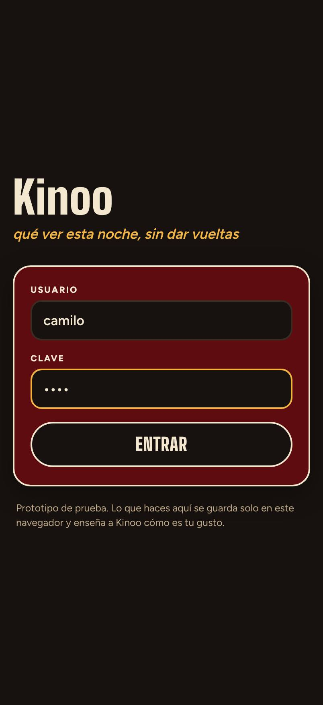
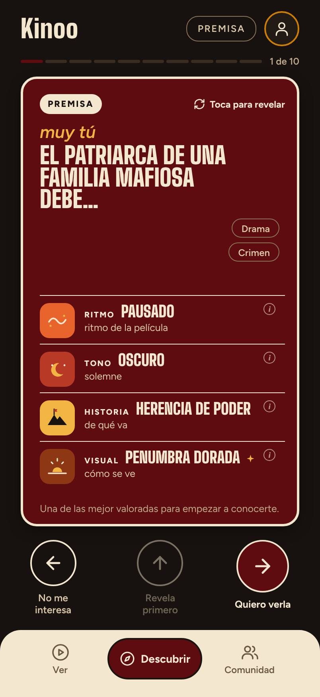
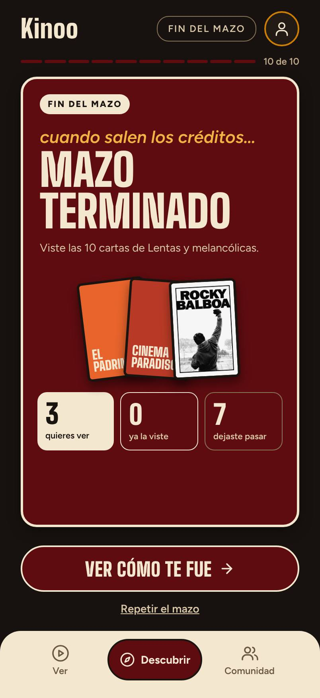
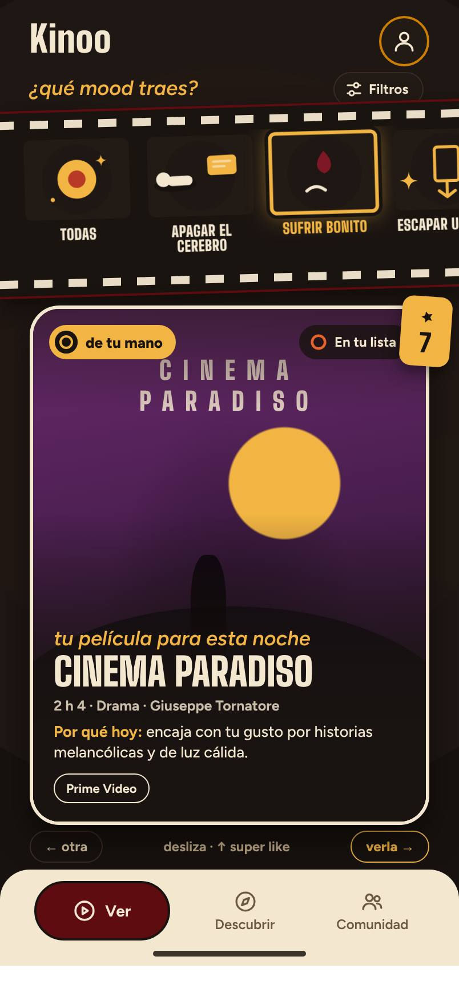

# Cómo se perfilan los usuarios en Kinoo

**Para qué sirve esto.** Responde la pregunta más importante del algoritmo: *¿Kinoo entiende a la persona que lo usa?* Para responderla simulamos a Camilo usando la app de verdad (con su usuario y clave) y a otros cinco tipos de usuario recorriendo el mismo motor. Aquí están los resultados, qué funciona, qué no y qué recomendamos.

*Simulación del 5 de noviembre de 2026 con el catálogo de 69 películas. Se repite con `npm run sim:camilo` y `npm run sim:perfiles`.*

---

## En una frase

**Sí lo entiende, y rápido:** con unas 14 señales (un mazo y medio) el perfil ya se parece al gusto real de la persona, y a los 6 tipos de usuario les sale el arquetipo esperado. Lo que hoy limita la experiencia no es el algoritmo, sino tres cosas del entorno: **no hay onboarding en el prototipo**, **el catálogo es pequeño** y **"Llorar bonito" necesita más uso para volverse personal**.

---

## Cómo se hizo la simulación

**Usuarios simulados.** Cada uno tiene un *gusto oculto* escrito en los 21 átomos (por ejemplo: "melancólico, que mueva por dentro, íntimo; nada de comedia tonta"). El motor no conoce ese gusto: solo ve lo que la persona hace. La persona acepta una película si de verdad le encaja (el 25 % del catálogo que más se parece a su gusto) y se equivoca el 10 % de las veces, como cualquiera.

**Qué medimos:**

| Medida | Qué dice | Cómo leerla |
|---|---|---|
| **Aciertos del mazo** | De 10 cartas, cuántas le gustan de verdad | El azar daría 2 o 3 de 10 |
| **Parecido del perfil** | Coseno entre lo que aprendió Kinoo y el gusto oculto | 1 = idéntico; 0,7 o más = lo entiende bien |
| **Perfil confiable** | Señales hasta que el parecido llega a 0,7 | Menos es mejor |
| **Arquetipo** | La carta de perfil que le asigna Kinoo | ¿Coincide con la esperada? |

---

## 1. Camilo usando la app

Un navegador entró a la demo publicada como **camilo / 1234**, jugó 4 mazos de Descubrir tocando "Quiero verla" o "No me interesa" y, cada noche, aceptó la propuesta de Ver, "salió a la plataforma" y calificó en la pantalla de Calificar.

**El gusto que le asignamos (hipótesis, no lo medimos en el Camilo real):** cine de autor emotivo y de luz cálida, melancólico e íntimo, con interés por el terror psicológico. Le aburren la comedia tonta y la acción ruidosa.

<p>




</p>

| Mazo | Le gustaron | Lo que le dijo Kinoo al cerrar | Esa noche vio | Arquetipo | Parecido |
|---|---|---|---|---|---|
| 1 | **3 de 10** | "Hoy te inclinaste por historias a fuego lento y melancólicas." | *Cinema Paradiso* · Me encantó | El Romántico | 0,66 |
| 2 | **8 de 10** | "Hoy te inclinaste por historias contemplativas y íntimas." | *Estación central de Brasil* · Me encantó | El Romántico | 0,74 |
| 3 | **6 de 10** | "Hoy te inclinaste por historias que exigen atención y épicas." | *Rocky Balboa* · Me encantó | El Romántico | 0,77 |
| 4 | **1 de 10** | "Este mazo nos ayudó a conocerte un poco más." | *Vidas pasadas* · Me encantó | El Romántico | **0,81** |

**Qué pasó:**

- **Mazo 1, arranque en frío.** La demo no tiene onboarding, así que el primer mazo es "las mejor valoradas" más el mazo del Equipo Kinoo. Le gustaron 3: *El padrino*, *Cinema Paradiso* y *Rocky*.
- **Desde el mazo 2, lo entiende.** Con solo 11 señales, el segundo mazo trajo *Estación central de Brasil*, *Aftersun*, *Vidas pasadas*, *Her*, *Roma* y *El abrazo de la serpiente*: **8 de 10**, con explicaciones como *"Encaja con tu gusto por historias melancólicas y que mueven por dentro."*
- **Las 4 propuestas de Ver le encantaron.** Ver elige de lo que guardó, así que acierta casi siempre.
- **El mazo 4 tuvo 1 de 10 porque se le acabaron las películas**, no porque el perfil empeorara: su parecido siguió subiendo (0,81). De las 69 películas, solo unas 18 son "de Camilo", y en 3 mazos ya las había visto casi todas.
- **El arquetipo fue El Romántico desde el primer mazo** (íntimo, de luz cálida, que mueve por dentro), que es el que le corresponde.

Lo que Kinoo cree de Camilo al final (de −1 a +1): **íntimo 0,42 · melancólico 0,41 · a fuego lento 0,36 · que mueve por dentro 0,32**. Su gusto oculto era *melancólico, que mueve por dentro, íntimo, de luz cálida, que exige atención*. Acertó 3 de los 4 rasgos principales; "a fuego lento" también es parte de su gusto, solo que con menos peso.

---

## 2. Seis tipos de usuario

Cada persona hizo el recorrido completo que propone la especificación: elegir plataformas, **6 duelos "¿Esta o esta?"**, 5 mazos de 10 (uno de cada tres en "Llorar bonito" si tiene su propia idea de ese mood) y, cada noche, ver la propuesta de Ver.

| Persona | Gusto oculto | Perfil confiable en | Mazo 1 | Mazo 2 | Arquetipo (esperado) | Lo que aprendió Kinoo |
|---|---|---|---|---|---|---|
| **Camilo** (hipótesis) | Autor emotivo, íntimo, melancólico | 14 señales | 8 / 10 | 7 / 10 | El Romántico ✅ | íntimo · contemplativo · melancólico |
| **Valentina** · adrenalina | Acción, escala épica, frenética | 13 | 8 / 10 | 6 / 10 | El Explorador ✅ | frenética · épica · neón · tensa |
| **Andrés** · plan familiar | Animación, humor, nada oscuro | 18 | 6 / 10 | 4 / 10 | El Luminoso ✅ | luminosa · reconfortante · cálida |
| **Laura** · noche de miedo | Terror, inquietante, sombrío | 13 | 7 / 10 | 6 / 10 | El Nocturno ✅ | inquietante · sombría · tensa |
| **Jorge** · clásicos | Dramas complejos, crimen, setentas | 24 | 5 / 10 | 6 / 10 | El Observador ✅ | sombría · compleja · tensa |
| **Sofía** · de todo un poco | Comedia romántica, drama luminoso | 13 | 7 / 10 | 6 / 10 | El Luminoso ✅ | luminosa · reconfortante · cálida |

*Con el azar, el mazo 1 tendría unos 2,6 aciertos de 10.*

**Lo que muestra:**

1. **Los 6 arquetipos salieron bien.** En dos casos el primer mazo dio otro (Camilo salió El Observador y Jorge, El Nocturno), pero se corrigieron en el mazo 2.
2. **Con onboarding, el primer mazo ya acierta de 5 a 8 de 10.** Sin onboarding (Camilo en la app) acertó 3 de 10. **Los 6 duelos valen tanto como un mazo entero.**
3. **Los gustos claros se perfilan más rápido** (Valentina y Laura, 13 señales). Los gustos mezclados tardan más: Jorge, que combina drama, crimen y cine clásico, necesitó 24.
4. **Los gustos amplios se diluyen cuando se acaba el catálogo.** Cuando a Sofía ya no le quedaban películas que le gustaran, descartó todo y su perfil bajó de 0,69 a 0,58. Con un catálogo grande no le pasaría.
5. **Ver casi nunca falla:** 24 de las 30 noches simuladas terminaron en "Me encantó" y 6 en "Estuvo bien"; ninguna en "No era para mí".

### "Llorar bonito" personal

| Persona | Cómo entiende "Llorar bonito" | Parecido de su receta con la semilla | Qué subió |
|---|---|---|---|
| Camilo | Lento, íntimo, de luz cálida | 0,90 (cambió poco) | a fuego lento, contemplativa |
| Andrés | Emotivo pero luminoso, familiar | **0,61** (cambió bastante) | luminosa, cálida, tonos pastel |

La receta se vuelve personal (la de Andrés ya pide películas luminosas y familiares para llorar). Pero con solo 2 mazos en ese mood, la de Camilo apenas se movió, porque su idea se parece a la semilla. **Hace falta usar el mood varias veces** para que se note, y hoy **Descubrir no deja elegir mood** (solo Ver lo permite).

---

## 3. Qué funciona

- **Aprende rápido:** perfil confiable en 13 a 24 señales, es decir, 1 o 2 mazos.
- **Generaliza bien:** a Camilo le recomendó películas que no había visto en ningún mazo anterior (*Aftersun*, *Roma*, *El abrazo de la serpiente*) por sus rasgos, no por su género.
- **Explica en palabras y sin números**, y las razones coinciden con el gusto real: *"Encaja con tu gusto por historias íntimas y melancólicas."*
- **No se queda en la burbuja:** cada mazo trae una "sorpresa" y un "comodín" (por ejemplo, *Interstellar* o *Scarface* para Camilo).
- **El cierre del mazo resume bien** cuando hay información y, desde este cambio, **no inventa** cuando no la hay.

## 4. Qué ajustamos con esta simulación

| Problema | Antes | Ahora |
|---|---|---|
| El cierre del mazo concluía con una sola carta guardada | "Hoy te inclinaste por historias inquietantes y tensas" (había guardado 1 de 10) | Con menos de 2 guardadas: *"Este mazo nos ayudó a conocerte un poco más."* El mínimo es `closing_min_saves` en `params.json` |
| Frase del curador mal construida | "La guardó Equipo Kinoo, que también disfruta lo melancólicas" | "La guardó Equipo Kinoo, a quien también le gustan las historias melancólicas" |

## 5. Recomendaciones

| # | Recomendación | Por qué | Esfuerzo |
|---|---|---|---|
| 1 | **Poner los 6 duelos "¿Esta o esta?" en el front** antes del primer mazo | Sube el primer mazo de 3 a entre 5 y 8 aciertos de 10. El endpoint ya existe (`onboarding`) | Diseño y front |
| 2 | **Agrandar el catálogo** a las 300 del piloto (o al menos 150) | Con 69, a partir del tercer mazo se acaban las películas buenas para cada persona y el mazo parece "malo" | Clave de TMDB |
| 3 | **Dejar elegir mood en Descubrir** (sobres por mood) | Es la única forma de que "Llorar bonito" se vuelva personal rápido | Diseño y front |
| 4 | **Avisar cuando se acaban las recomendaciones fuertes** ("Ya viste lo más tuyo; ¿exploramos?") | Evita que el usuario sienta que la app dejó de entenderlo | Pequeño |
| 5 | **Probar con personas reales** usando el usuario de prueba | La simulación supone que la gente decide por gusto y se equivoca el 10 % de las veces; la gente real también decide por ánimo y por lo que ya vio | Prueba de usabilidad |

---

## 6. Cómo probarlo tú

1. Abre la demo: https://montenegroc597-web.github.io/Prototipo-Kinoo/ (cuando GitHub Pages esté activo).
2. Entra con **camilo / 1234**.
3. Juega 2 mazos de Descubrir siendo honesto con tu gusto.
4. Abre la consola del navegador y escribe `KinooDemo.profile()`: verás tus rasgos más fuertes y tu arquetipo.
5. Para empezar de cero, `KinooDemo.reset()`. Para cambiar de usuario, ve a `entrar.html` y elige "Salir".

Tu historial se guarda solo en ese navegador y en esa cuenta.

## Ejemplo con números

Camilo guarda *Aftersun* en el mazo 2. Su rasgo distintivo melancólico es 0,9 y su perfil en melancolía estaba en 0,25. Con "guardar" (`w = 0,5` sin voltear, `η = 0,08`):

```
0,25 + 0,08 × (0,5 × 0,9 − 0,25) = 0,25 + 0,08 × 0,20 = 0,266
```

Esa noche Ver le propone *Estación central de Brasil* y le encanta (`w = 1,0`, `η = 0,25`, rasgo distintivo melancólico 0,57):

```
0,266 + 0,25 × (0,57 − 0,266) = 0,342
```

Guardar movió el valor 0,016; verla y disfrutarla lo movió 0,076, casi cinco veces más. Por eso conectar Ver ("¿la viste?") es tan importante como Descubrir.
