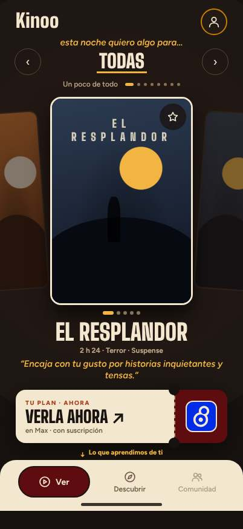
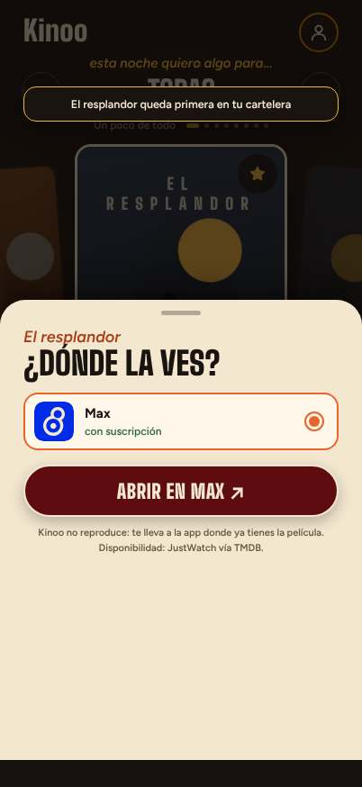
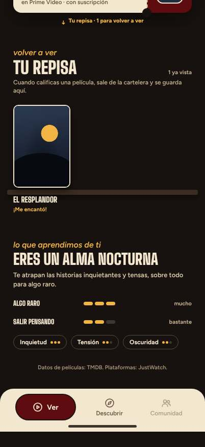
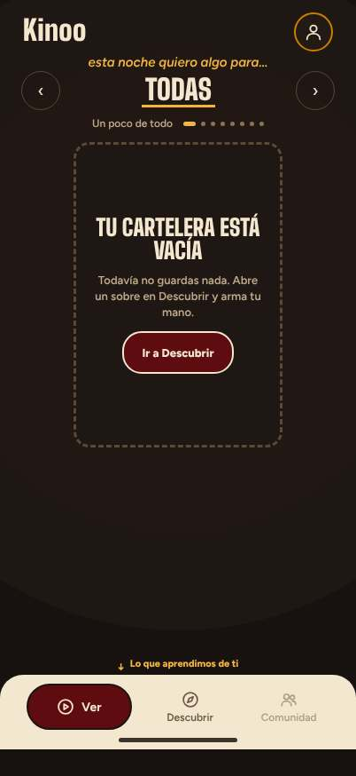
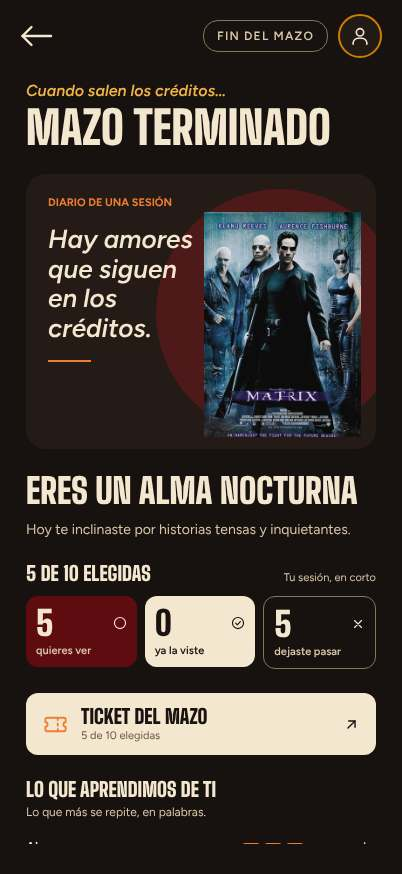
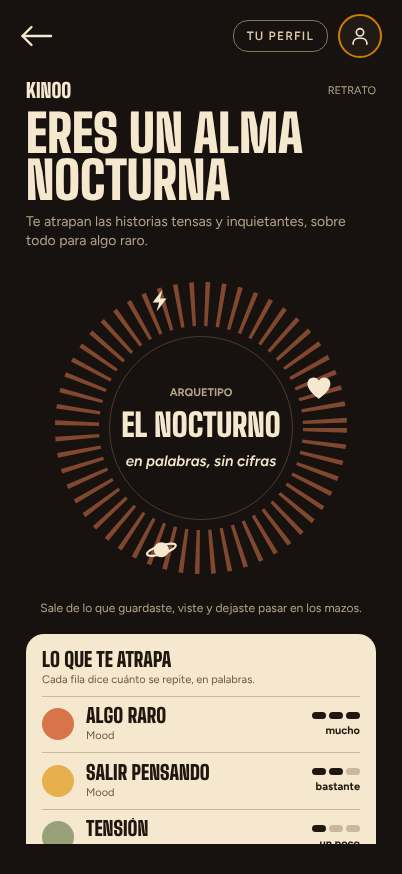
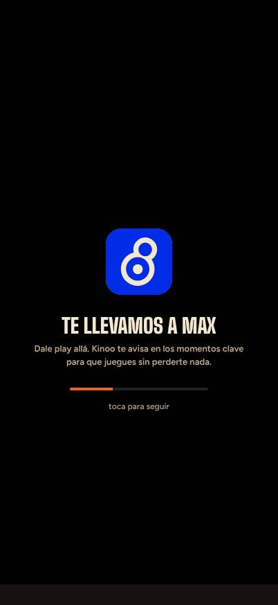
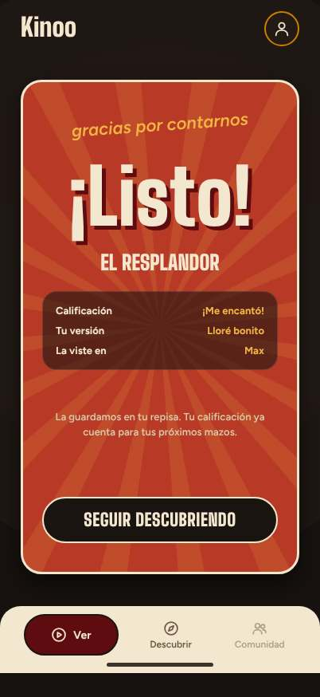

**Para qué sirve esto.** Es el informe final de la auditoría de Kinoo (fase F11). Cuenta qué hizo cada rol del equipo, qué funciones de la app son reales y cuáles siguen siendo maqueta, cómo se probó cada una, qué se encontró (lo arreglado y lo pendiente) y qué decisiones le quedan al equipo. Si solo tienes cinco minutos, lee la tabla de funciones y la lista de pendientes.

# Informe de la auditoría de Kinoo (F11)

*17 de noviembre de 2026 · rama `back/algoritmo-v2` · demo en el navegador (modo demo, sin servidor), catálogo de 69 películas (simulación de TMDB).*

## En una frase

**La app ya dice la verdad sobre la persona:** "lo que el mazo dice de ti" sale de sus swipes reales, Ver es la cartelera nueva (B7c) con estrella, plataformas reales y repisa, y ninguna pantalla muestra porcentajes ni números de afinidad. Lo que sigue siendo maqueta es lo que todavía no tiene datos detrás: minijuego, elección del próximo mazo, momentos clave durante la película y la nota de voz.

---

## 1. Qué hizo cada rol

| Rol | Qué hizo | Dónde quedó |
|---|---|---|
| **UX-UI** | Recorrió las 14 pantallas a 402 × 874, midió botones, contraste, textos y enlaces; dejó una lista priorizada y la especificación de Ver B7c (estados, estados vacíos, accesibilidad, qué no se lleva del mockup). | [ux-ui.md](ux-ui.md), [especificacion-ver-b7c.md](especificacion-ver-b7c.md), capturas `img/02…16` |
| **Back** | `insight()` (lo que el mazo dice de ti, con niveles en palabras), `billboard()` y `moods()` (cartelera por mood), `shelf()` (repisa), `star()` con el evento nuevo `super_liked`, `rewatch()`, `lastWatch()`; calificar saca la película de la cartelera; migración 0009; endpoints HTTP y su contrato. | `packages/engine/src/{insight,billboard}.ts`, `apps/web/src/demo.ts`, [contrato-api.md](../guias/contrato-api.md) |
| **Front** | Reemplazó Ver por el diseño B7c y conectó Resumen, Ticket, Perfil, Abriendo, Calificar, Versión y Gracias al puente. Quitó todos los porcentajes y datos inventados de la persona. Creó el manifiesto del front y `npm run check:front`. | `apps/web/public/kinoo-flujo/*`, [front.manifest.json](../../apps/web/front.manifest.json), [actualizar-el-front-con-ia.md](../guias/actualizar-el-front-con-ia.md) |
| **Tester-integrador** (este informe) | Adaptó las 4 e2e que seguían la Ver vieja, escribió 4 e2e nuevas de punta a punta, arregló la auditoría de textos para que mida de verdad los contenedores con scroll, cerró los pendientes pequeños del back, recorrió la app en el navegador y corrió la simulación. | `apps/web/e2e/*`, este documento, `img/f11-*.jpg` |

## 2. Funciones de la app: estado y cómo se probó

**Real** = sale del motor con las acciones de la persona. **Parcial** = funciona, pero falta una parte. **Maqueta** = datos fijos o la acción no se guarda.

| Función | Pantalla | Estado | Cómo se probó |
|---|---|---|---|
| Inicio de sesión de la demo (camilo / 1234), historial por cuenta | `entrar.html` | Real (local, en el navegador) | `login.spec.ts` (3 e2e) |
| Mazo de 10 cartas: frente, reverso, "Quiero verla", "No me interesa", "Ya la vi" | Descubrir | Real | `motor.spec.ts`, `cartas.spec.ts` (69 películas), `ver-y-perfil.spec.ts` |
| Ficha ADN de la película | Descubrir | Real | `cartas.spec.ts` (69 películas, sin textos fuera ni montados) |
| Cierre del mazo: frase, pósters guardados, conteos | Descubrir | Real | Unitaria nueva de conteos; e2e "Resumen y Ticket…" |
| Resumen del mazo: conteos, frase, "lo que aprendimos de ti" | Resumen | Real (conteos de `lastClosing().counts`) | e2e "Resumen y Ticket…" y "lo que el mazo dice de ti" |
| Recibo del mazo: mood, pósters, conteos | Ticket | Real | e2e "Resumen y Ticket…" |
| Tu retrato: arquetipo, frase, moods y rasgos en palabras | Perfil | Real | e2e "lo que el mazo dice de ti" (vacío, romántico, nocturno) |
| Minijuego "¿Esto o aquello?" | Minijuego | **Maqueta** (la respuesta no se guarda) | Solo auditoría de textos |
| Elegir el próximo mazo / mazo listo | Elección, Inicio | **Maqueta** (mazos fijos) | Solo auditoría de textos y enlaces |
| Cartelera por mood, en el orden del motor | Ver | Real | e2e "cartelera…" (recorre los 8 moods) |
| Estrella (`super_liked`): la película queda primera | Ver | Real | e2e "cartelera…" y unitarias del motor |
| Hoja "¿Dónde la ves?" con las plataformas de la película | Ver | Real (plataformas del catálogo simulado; sin alquiler ni precios) | e2e "cartelera…" compara con el catálogo |
| Repisa de ya vistas y "Repetirla" | Ver | Real | e2e "calificar saca la película…" |
| "Lo que aprendimos de ti" (bloque de Ver) | Ver | Real | e2e "lo que el mazo dice de ti" |
| Te llevamos a {plataforma} | Abriendo | Parcial: dice la plataforma real, pero no abre la app (no hay enlace profundo) | e2e "calificar…" y `motor.spec.ts` |
| Momentos clave durante la película | Función | **Maqueta** (preguntas fijas de Interstellar; P8.1) | Solo auditoría de textos |
| Calificar con la aguja (5 niveles) | Calificar | Real (el nivel se guarda en Versión) | e2e "calificar…" (nivel "Estuvo bien" con el teclado) |
| "¿Qué versión de ti salió?" | Versión | Parcial: la versión solo se muestra en Gracias (P9.2); la nota de voz es de mentira | e2e "calificar…" |
| Cierre de la calificación: película, calificación, versión, plataforma | Gracias | Real | e2e "calificar…" |
| Duelos "¿Esta o esta?" (arranque en frío) | — | Parcial: existe en el back (`onboarding`), no hay pantalla | Unitarias del motor y simulación |
| Comunidad | Barra inferior | No existe (atenuada, "Pronto") | Recorrido |
| API HTTP y base de datos (Supabase u otra nube) | — | Real en código, no desplegada | Pruebas de integración con PGlite |

## 3. Resultados de las pruebas

| Prueba | Comando | Resultado |
|---|---|---|
| Lint, tipos, `check:front`, semillas, pósters, unitarias e integración, build y rutas | `npm run check` | **Verde.** 16 archivos, **148 pruebas** (antes 146: +2 nuevas), 14 pantallas del manifiesto, 86/86 rutas. 18 s |
| E2E en el navegador | `PW_CHROMIUM_PATH=/opt/pw-browsers/chromium npm run test:e2e` | **Verde: 14 de 14** (antes 10, con 4 en rojo), en 6 min 3 s |
| Simulación de 6 tipos de usuario | `npm run sim:perfiles` | **6 de 6 arquetipos**, mismos números que el 5 de noviembre (perfil confiable en 13 a 24 señales; 24 noches "Me encantó" y 6 "Estuvo bien"). Ver [SIMULACION-PERFILAMIENTO.md](../SIMULACION-PERFILAMIENTO.md) |
| Recorrido en el navegador a 402 × 874 | script temporal con Playwright | 0 excepciones de JavaScript, 0 porcentajes, 0 enlaces rotos ni sin destino, conteos iguales en el cierre, Resumen y Ticket (5 / 0 / 5) |

**E2E que se adaptaron a la Ver nueva:**

1. `cartas.spec.ts` "Ver…": ahora pasa de carta con `[data-k=next]` y recorre las **69 películas** en lotes de 10 (la cartelera muestra hasta 10), más la parte de abajo (repisa y lo aprendido).
2. `cartas.spec.ts` "pantallas fijas": pasa, y ahora sí mide el contenido con scroll (antes lo ignoraba).
3. `motor.spec.ts` flujo principal: Ver → ticket → plataforma → Abriendo; Calificar ya no guarda; el `watch_confirmed` se crea al tocar Continuar en Versión, y ahí se comprueba que el perfil cambió.
4. `motor.spec.ts` "sin el motor": comprueba que "% contigo" **no** aparece.

**E2E nuevas** (`apps/web/e2e/ver-y-perfil.spec.ts`), con el puente real:

- **Lo que el mazo dice de ti:** sesión vacía → Perfil dice "Por descubrir" y Ver muestra el texto vacío; 8 románticas guardadas y 8 inquietantes descartadas → "El Romántico", con rasgos de su receta en Perfil, Resumen y Ver; al revés → "El Nocturno" con otros rasgos. En ninguna pantalla aparece una cifra con %, "/100" ni "match", y ningún texto se sale ni se monta.
- **Cartelera:** cambiar de mood cambia las películas (en el orden del back); la estrella deja la película primera; la hoja trae exactamente las plataformas del catálogo.
- **Calificar:** Ver → segunda plataforma → Abriendo dice esa plataforma → "Estuvo bien" → Gracias dice película, plataforma y la calificación de la repisa → la película sale de la cartelera y entra a la repisa → "Repetirla" la devuelve.
- **Resumen y Ticket:** un mazo jugado por la interfaz (4 / 1 / 5) muestra los mismos conteos en el cierre, Resumen y Ticket, y si el cierre ya concluyó un gusto, Resumen también lo muestra.

## 4. Hallazgos

### Arreglados en esta fase (por el tester)

| Severidad | Hallazgo | Arreglo |
|---|---|---|
| Alta | **Incoherencia entre pantallas:** tras un primer mazo normal (5 guardadas, 5 descartadas), el cierre decía "Hoy te inclinaste por historias tensas e inquietantes", pero Resumen, Perfil y Ver decían "Desliza unas cartas más…". El perfil más alto era 0,041 y el umbral de rasgos, 0,05. | `insight_trait_min` baja de 0,05 a 0,03 (`params.json`, semillas regeneradas). Prueba unitaria con el catálogo real (6 mazos) y aserción en la e2e. Decisión anotada en PROGRESS |
| Media | **Perfil cortaba el arquetipo:** a 38 px, ningún nombre cabía en el hueco de 180 px ("El Explorador" mide 216). Se veía "POR DESCUBRI…". | Tamaño 32 px hasta 12 letras y 30 px para el resto |
| Media | **La auditoría de textos no veía Ver ni las pantallas con scroll:** trataba cualquier contenedor con `overflow-y:auto` como carrusel horizontal y no medía nada adentro. | Solo es carrusel lo que de verdad se desplaza en horizontal; lo que queda debajo del borde de un scroll vertical no cuenta; el margen de 2 px solo aplica a cajas dibujadas |
| Media | **Resumen y Ticket recalculaban los conteos** desde los eventos (podían no coincidir con el cierre). | `lastClosing()` trae `counts` (quieres ver / ya la viste / dejaste pasar) y `vibe` del mazo, calculados en el motor; las dos pantallas los usan |
| Media | **"Netflix" inventado:** si no llegaba plataforma, `onWatch` guardaba `provider: 'Netflix'`, y `watchFilms` agregaba Netflix a películas sin plataformas. | Se quitó. `watch_started.provider` es opcional |
| Baja | Resumen tenía una frase fija de la maqueta, "Hay amores que siguen en los créditos.", al lado del póster real (por ejemplo, *Matrix*). | Frase neutra: "Así se jugó tu mazo." |
| Baja | `shelf()` no traía `title_size` para la carta de "ya vistas". | Agregado, con la misma regla que la cartelera |
| Baja | `limites-de-texto.md` seguía diciendo que Resumen, Perfil y Función mostraban porcentajes. | Sección "Pendientes" actualizada |

### Pendientes

| Severidad | Hallazgo | Qué hacer |
|---|---|---|
| Media | **Errores 404 en la consola** en casi todas las pantallas: el navegador pide `{{card.img}}`, `{{cur.img}}`, `{{tk.logo}}`… antes de que el motor de plantillas las reemplace (39 en un recorrido). En Calificar sale además `<path d="{{hl}}">`. No se ve, pero ensucia la consola. | Cambio del runtime de plantillas o de cómo se escriben `src`/`d` (front). No es pequeño |
| Media | El enlace "↓ Tu repisa / Lo que aprendimos de ti" de Ver mide 310 × 26 (debería tener 44 de alto). No cabe más alto sin mover el ticket. | Decisión de diseño (UX-UI) |
| Baja | En Calificar y Versión, el enlace "← Calificación" mide 122 × 36. En Descubrir, los 4 botones "i" miden 33 × 33 y "Repetir el mazo", 99 × 30. | Front: subir a 44 de alto |
| Baja | Versión: la nota de voz simula una grabación (no graba nada). | Quitarla o marcarla "pronto" hasta que exista (P9) |
| Baja | Abriendo dice la plataforma, pero no abre la app (no hay enlaces profundos). | Back + front, cuando haya enlaces de JustWatch |
| Baja | El detector marca como "montados" el aviso flotante sobre el selector de mood y la hoja sobre la carta: son capas a propósito, no errores. En el Minijuego, la capa de "Se acabó el tiempo" también. | Nada; si molesta, el detector puede ignorar capas con `role=dialog`/`status` |
| — | Lo que **no** se probó: el modo Supabase en la nube, el catálogo real de TMDB (la atribución larga solo se ve con `source === 'tmdb'`), lectores de pantalla y teléfonos reales. | Probar cuando haya clave de TMDB y despliegue |

## 5. Decisiones abiertas para el equipo

Están en [PREGUNTAS-RECOLECCION-DE-DATOS.md](../PREGUNTAS-RECOLECCION-DE-DATOS.md). Las que más afectan lo que se construyó en F11:

- **P7.3 · Estrella:** se tomó "la quiero ver sí o sí" (+0,8, η 0,12). ¿Es eso, o es "para después"?
- **P7.4 / P7.5 · Pasar de carta en Ver:** hoy no es una señal. ¿Hace falta un botón "otra" que mande `watch_skipped`?
- **P8.1 · Función (momentos clave):** ¿entra en la v1? Hoy es maqueta.
- **P9.1 · "Me dormí":** hoy cuenta como "No era para mí". **P9.2 · Versión:** hoy solo se muestra en Gracias; ¿debe mover el perfil o el mood?
- **Umbral de "lo que el mazo dice de ti"** (`insight_trait_min` 0,03, `insight_min_signals` 6): son supuestos; se ajustan con datos de personas reales.

## 6. Cómo actualizar el front con IA

Paso a paso y prompt listo para copiar en [actualizar-el-front-con-ia.md](../guias/actualizar-el-front-con-ia.md). En corto: leer la ficha de la pantalla en `apps/web/front.manifest.json`, cambiar el `.dc.html` sin calcular nada del algoritmo, mantener la ficha al día y correr `npm run check:front`, `npm run check` y las e2e. Las e2e de Ver usan los atributos `data-k` de la ficha (`card`, `title`, `next`, `ticket`, `plat`, `open`, `star`, `shelf-item`, `insight`…): si se cambian, hay que cambiar también `apps/web/e2e/ver-y-perfil.spec.ts`.

## Capturas

## Ejemplo con números

Recorrido real del 17 de noviembre en el navegador, cuenta camilo, sesión vacía:

- En Descubrir guardó 5 cartas y dejó pasar 5. El cierre dijo **"Hoy te inclinaste por historias tensas y inquietantes."** y `lastClosing().counts` fue `{ want: 5, seen: 0, pass: 5 }`. Resumen y Ticket mostraron **5 / 0 / 5**, los mismos.
- Su perfil más alto tras ese mazo: tensa **0,041** e inquietante **0,041**. Con el umbral anterior (0,05) Perfil decía "Por descubrir"; con 0,03 dice **"ERES UN ALMA NOCTURNA"**, arquetipo **El Nocturno**, moods "Algo raro" (mucho) y "Salir pensando" (bastante). Ninguna cifra en pantalla.
- En Ver, "Todas" tenía 5 películas; *El resplandor* subió primera con la estrella. La hoja trajo **1** plataforma (Max), la única que tiene en el catálogo. Abriendo dijo "Te llevamos a Max" y Gracias, "¡Me encantó! · Lloré bonito · Max".
- Pruebas al cerrar: `npm run check` con **148** unitarias e integración en verde, y **14 de 14** e2e en verde en **6 minutos** (6 min 3 s; las de textos de las 69 películas toman 5,3 min).
