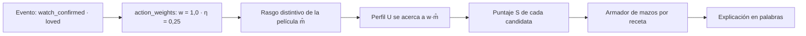

# El algoritmo, paso a paso

**Para qué sirve esto.** Sigue un evento real ("Ana vio *Past Lives* y le encantó") desde que llega hasta que cambia su mazo de Descubrir. Así se ve qué hace cada pieza del motor (`packages/engine`) y qué número de la configuración la controla.

## El recorrido



| Paso | Archivo del motor | Qué lo controla |
|---|---|---|
| 1. El evento llega | `profile.ts` (`applyEvent`) | Tipos de `packages/shared/src/events.ts` |
| 2. Se traduce a señal | `learning.ts` (`signalsOf`) | `packages/config/data/action_weights.json` |
| 3. Rasgo distintivo | `distinct.ts` | Promedio del catálogo (se calcula solo) |
| 4. Aprende | `learning.ts` (`applySignal`) | `distinct_threshold` (τ) en `params.json` |
| 5. Puntúa | `score.ts` | β, γ en `params.json`; `quality_weight` del mood |
| 6. Arma el mazo | `deck.ts` | `deck_recipes.json`; umbrales de comodín, sorpresa y diversidad |
| 7. Explica | `explain.ts` | `explanation_templates.json`, etiquetas de `atoms.json` |
| 8. Cierra el mazo | `closing.ts` | Plantillas `deck_learned*` |
| Ver | `watch.ts` | `watch_*` en `params.json` |
| Onboarding y arquetipo | `onboarding.ts` | `onboarding_*`, `archetypes.json` |

## Reglas que conviene recordar

- **El motor no conoce gestos.** Recibe acciones (`saved_intent`, `dismissed`…). El front decide con qué gesto se hace cada una.
- **No aprende de ausencias.** Solo se mueven los átomos en los que la película sobresale (`m̂ > τ = 0,2`).
- **Nunca se satura.** Cada evento acerca el valor a su objetivo; nunca pasa de −1 ni de +1.
- **Fatiga de descarte.** Lo muy parecido a lo que descartaste en las últimas 24 horas baja en el mazo (`dismiss_fatigue_weight = 0,3`). Es la lectura de "hoy no".
- **Se puede recalcular.** `replay()` vuelve a pasar todos los eventos. Si cambias un peso, el perfil se recalcula igual.

## Cómo sabemos que aprende

`npm run test:sim` corre usuarios simulados: personas sintéticas con un gusto oculto que guardan o descartan según ese gusto. Resultados en [`packages/engine/sim/RESULTADOS.md`](../../packages/engine/sim/RESULTADOS.md). Con la configuración actual pasan las cinco pruebas de la sección 16. Lo más importante: tras 40 eventos, el mazo trae **6,4 veces** más películas "aceptables" que un mazo al azar.

## Ejemplo con números

Catálogo de juguete con cuatro películas: *Past Lives*, *Aftersun*, *Mad Max* y *Supercool*.

**1. Promedio del catálogo (μ).** Por ejemplo, `melancolica` = 0,513 e `intimidad` = 0,488.

**2. Rasgo distintivo de *Past Lives*.** Su `melancolica` es 0,95:

```
m̂ = (0,95 − 0,513) / (1 − 0,513) = 0,897
```

Sus rasgos distintivos: melancólica 0,897, íntima 0,805, carga emocional 0,707, pausada 0,652, cálida 0,319. Las otras 16 valen 0.

**3. El evento.** Ana confirma "Me encantó". `action_weights.json` dice `w = 1,0` y `η = 0,25`. Su perfil empieza en 0:

```
melancolica: 0 + 0,25 × (1,0 × 0,897 − 0) = 0,224
intimidad:   0 + 0,25 × (1,0 × 0,805 − 0) = 0,201
humor:       no cambia (Past Lives no sobresale en humor)
```

**4. Puntaje de *Aftersun*.** Sin mood, β = 1. La calidad de una película con nota 7 y 1.000 votos es `(1000·7 + 500·6,5) / 1500 / 10 = 0,683`:

```
S = 1 × cos(U, m̂) + 0,10 × 0,683 = 0,953 + 0,068 = 1,021
```

*Mad Max* y *Supercool* no comparten rasgos con el perfil: su coseno es 0 y solo suman la calidad (0,068).

**5. Explicación.** Los dos átomos que más aportan en *Aftersun* son melancólica y carga emocional:

> Encaja con tu gusto por historias melancólicas y que mueven por dentro.

Para *Mad Max* no hay ningún átomo en común, así que dice:

> Algo distinto a lo que sueles guardar, para ampliar el mazo.

Ninguna frase tiene números: es una regla dura con prueba automática.
