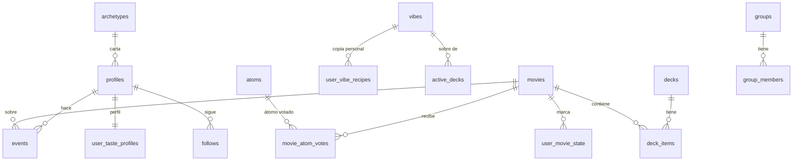

# Base de datos

**Para qué sirve esto.** Explica qué guarda cada tabla de Kinoo en Supabase y cómo se relacionan. Sirve para saber dónde vive cada cosa antes de cambiarla.

## Tres ideas

- **Lo ajustable vive en tablas.** Pesos, moods, recetas de mazo y plantillas son filas, no código. Su fuente editable son los JSON de `packages/config/data/`. `npm run db:seeds` los convierte en SQL (`packages/db/seeds/`).
- **Los eventos mandan.** `events` solo acepta filas nuevas: un trigger impide editarlas o borrarlas. Los perfiles y las marcas se calculan a partir de los eventos.
- **Cada persona ve lo suyo.** Las reglas de seguridad por fila (RLS) filtran por `auth.uid()`. El catálogo y la configuración son de lectura pública.

## Supabase u otra nube: los proveedores

Las migraciones son PostgreSQL estándar. Las reglas de seguridad preguntan quién es la persona con `kinoo_current_user()`, y esa función la define un **proveedor**:

| Proveedor | Archivo | `kinoo_current_user()` |
|---|---|---|
| Supabase | `packages/db/providers/supabase.sql` | `auth.uid()` (el JWT de Supabase Auth) |
| PostgreSQL genérico | `packages/db/providers/postgres.sql` | `app.user_id`, que pone la API en cada transacción. También crea los roles `anon`, `authenticated` y `service_role` |

`npm run db:migrate` aplica el proveedor, luego las migraciones que falten (registradas en `kinoo_migrations` con una suma de verificación) y las semillas. **Una migración publicada no se edita:** si cambió, el aplicador se detiene. Para el CLI de Supabase, `npm run supabase:build` arma `infra/supabase/migrations` desde la misma fuente.

## Tablas

### Configuración (`0001_configuracion.sql`)
| Tabla | Qué guarda |
|---|---|
| `atoms` | Los 21 átomos: clave, dimensión, etiqueta para explicar, descripción, orden |
| `vibes` | Moods: nombre, definición en una frase, receta semilla, alias, ejemplos, activo, versión |
| `archetypes` | Los cinco arquetipos de perfil y su receta en átomos |
| `action_weights` | Señal `w` y velocidad `η` de cada acción |
| `deck_recipes` | Posiciones y roles del mazo de 5, 10 y 20 |
| `explanation_templates` | Frases con huecos `{a}`, `{b}`, `{mood}`. La base rechaza números y % |
| `config` | Parámetros sueltos (τ, β, γ, umbrales) |

### Catálogo (`0002_catalogo.sql`)
| Tabla | Qué guarda |
|---|---|
| `movies` | Datos de TMDB, ADN (21 átomos), frase gancho, pilares, plataformas por país, trazabilidad del juez y columna `embedding` vacía |
| `catalog_atom_stats` | Promedio μ y desviación de cada átomo en el catálogo |
| `movie_atom_votes` | Votos de la comunidad sobre un átomo. No borran el valor del LLM |
| `movie_effective_atoms` (vista) | Valor que combina LLM y votos: `(k·M + Σ votos) / (k + n)` |

### Cada persona (`0003_usuarios.sql`)
| Tabla | Qué guarda |
|---|---|
| `profiles` | Nombre, arquetipo de perfil, si el perfil es público, país y plataformas |
| `consents` | Qué aceptó y cuándo, con la versión de la política (Ley 1581) |
| `events` | Todo lo que la persona hace. Solo se agrega |
| `user_taste_profiles` | Perfil global: un valor de −1 a +1 por átomo y `signal_count` |
| `user_vibe_recipes` | La copia personal de cada mood |
| `user_movie_state` | Marca actual por película: guardada, vista, repetir, descartada |
| `active_decks` | El mazo abierto en Descubrir, con el perfil de antes para el cierre |

### Social, sin pantallas (`0004_social.sql`)
| Tabla | Qué guarda |
|---|---|
| `follows` | Quién sigue a quién |
| `decks` / `deck_items` | Mazos con dueño (`system` = Equipo Kinoo, `curator`, `user`) y sus películas con nota |
| `lists` | Listas publicables |
| `groups` / `group_members` | La capa social privada de 2028 |

### Catálogo con datos de TMDB (`0007_catalogo_tmdb.sql`)
- `movies.imdb_id` y `movies.keywords`. La fuente puede ser `tmdb`, `tmdb_simulado` o `semilla_manual`.

### Seguridad y privacidad (`0005_rls.sql`, `0006_privacidad.sql`)
- RLS en todas las tablas.
- `kinoo_export_my_data()` devuelve en JSON todo lo de la persona que la llama.
- `kinoo_delete_my_data()` borra todo lo suyo, incluidos sus eventos. Deja en `consents` un registro del borrado.

## Relaciones



## Los datos de las pruebas de usabilidad

Viven en otro repositorio (`kinoo-pruebas`) y en otro proyecto de Supabase («Pruebas Kinoo»). Estas migraciones no los tocan. **No las apliques en ese proyecto:** crea uno nuevo para el producto (ver `despliegue.md`).

## Cómo se prueba

`npm run test:integration` crea bases PostgreSQL en memoria (PGlite con pgvector) con **los dos proveedores**, aplica las migraciones y las semillas, y verifica:

- Las 22 tablas existen y la semilla carga los 21 átomos.
- `events` no deja editar ni borrar.
- Ana no ve los eventos ni el perfil de Leo, y no puede escribir a nombre de Leo.
- Exportar y borrar afecta solo a quien lo pide.

## Ejemplo con números

*Past Lives* tiene `melancolica = 0,90` según el juez. Una persona vota que en realidad es `0,10`. Con `k = 10`:

```
(10 × 0,90 + 0,10) / (10 + 1) = 9,10 / 11 = 0,83
```

El motor usa 0,83. El 0,90 original sigue en `movies.atoms`. Con 10 votos de 0,10, el valor bajaría a `(9 + 1) / 20 = 0,50`.
