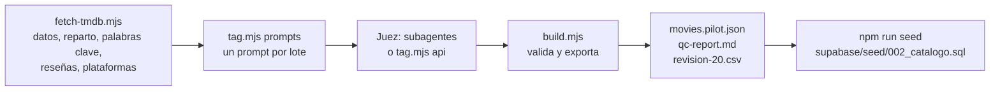

# El catálogo

**Para qué sirve esto.** Explica cómo entra una película a Kinoo, cómo se le ponen sus 21 átomos y cómo se agregan o se vuelven a etiquetar películas.

## Estado actual

- **34 películas de semilla manual** (`source = semilla_manual`), no las 300 del plan. Motivo: la sesión no tenía `TMDB_API_KEY` y la red bloqueaba `api.themoviedb.org`. Las cuotas se cumplen: 7 de 34 son anteriores al 2000 (21 %) y 6 de 34 son latinoamericanas (18 %).
- Incluye las películas que usa el prototipo (Interstellar, Her, Coco, Titanic, Matrix…) más cine latinoamericano y clásico.
- **Los metadatos son aproximados.** Duración, nota, votos y plataformas en Colombia se escribieron a mano. Se reemplazan al correr el pipeline con TMDB.
- Las etiquetas (átomos, frase gancho, pilares) las puso el juez sintético: dos subagentes con Sonnet, en lotes de 17.

## El recorrido



| Archivo | Qué es |
|---|---|
| `data/catalog/seed_movies.json` | Metadatos de la semilla manual |
| `data/catalog/anchors.json` | Películas ancla para calibrar al juez (**provisionales**) |
| `data/catalog/team_deck.json` | Mazo del Equipo Kinoo para el rol "creador" (**provisional**) |
| `data/catalog/batches/` | Prompts y respuestas del juez, lote por lote |
| `data/catalog/movies.pilot.json` | El catálogo final que usan el motor y el modo demo |
| `data/catalog/qc-report.md` | Resultado de los controles de calidad |
| `data/catalog/revision-20.csv` | 20 películas para revisión humana (columna `comentario_del_equipo`) |

## Controles de calidad (12.4)

| Control | Criterio | Resultado actual |
|---|---|---|
| Esquema | 21 átomos entre 0 y 1, 4 pilares, trazabilidad | ✅ 0 errores |
| Frase gancho | ≤ 160 caracteres, mayúsculas, sin nombres del director ni del reparto | ✅ |
| Dispersión | Desviación ≥ 0,15 en cada átomo | ✅ la menor es 0,21 |
| Contradicciones | Frenética y contemplativa no ambas > 0,8 | ✅ 0 alertas |
| Anclas | Error medio ≤ 0,15 | ✅ 0,052 |

**Ojo con las anclas.** Los valores de `anchors.json` los propuso el modelo que construyó el back, no el equipo. Un error bajo dice que el juez es coherente, no que esté de acuerdo con ustedes. Cuando el equipo fije sus valores, hay que volver a medir.

**Calibración sin trampa.** Las anclas se dividen en dos grupos. El lote que etiqueta las del grupo B ve como ejemplo solo las del grupo A, y al revés.

## Cómo traer las 300 películas de TMDB

1. Crea la clave en themoviedb.org → Configuración → API.
2. Guárdala como `TMDB_API_KEY` en el entorno (nunca en el código).
3. Permite la red a `api.themoviedb.org` e `image.tmdb.org`.
4. Corre:

```bash
node scripts/catalog/fetch-tmdb.mjs --target 300 --country CO
```

```bash
node scripts/catalog/tag.mjs prompts --input data/catalog/tmdb_movies.json --batch-size 20
```

5. Etiqueta: con `ANTHROPIC_API_KEY`, `node scripts/catalog/tag.mjs api`. Sin ella, pídele a Claude Code que lance un subagente por cada `batch-XX.prompt.md`.
6. Valida, exporta y genera la semilla SQL:

```bash
node scripts/catalog/build.mjs --input data/catalog/tmdb_movies.json --source tmdb
```

```bash
npm run seed
```

## Cómo agregar o re-etiquetar una película

- **Agregar:** añádela a `seed_movies.json` (o a `tmdb_movies.json`), genera los prompts, etiqueta solo el lote nuevo y corre `build.mjs`.
- **Re-etiquetar:** borra su entrada del `batch-XX.tagged.json`, vuelve a etiquetar ese lote y corre `build.mjs`. Si cambias el prompt, sube la versión en `scripts/catalog/lib.mjs` (`PROMPT_VERSION`): cada película guarda con qué versión se etiquetó.
- **Corregir un átomo:** no edites el valor del LLM. Lo corrige la comunidad con votos (`movie_atom_votes`, sección 13).

## Atribución

- TMDB exige este aviso donde se muestren sus datos: *"This product uses the TMDB API but is not endorsed or certified by TMDB."*, junto con su logo. El modo demo lo muestra.
- Los datos de plataformas vienen de JustWatch a través de TMDB, y también hay que atribuirlos.
- **Pendiente legal:** revisar los términos de uso comercial de TMDB y JustWatch antes de lanzar.

## Ejemplo con números

*Aftersun* es ancla del grupo B. Para el equipo, `melancolica = 0,95`. El juez, que solo vio como ejemplos a *Mad Max*, *Coco* y *Roma*, puso un valor cercano. Sumando la diferencia en los 21 átomos y dividiendo entre 21, su error es **0,065**. El promedio de las seis anclas es **0,052**, por debajo del límite de 0,15.
