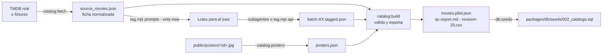

# El catálogo

**Para qué sirve esto.** Explica cómo entra una película a Kinoo, cómo se simula TMDB mientras no hay clave, cómo se le ponen sus 21 átomos y cómo se agregan películas y pósters.

## Estado actual

- **69 películas** en `packages/catalog/data/movies.pilot.json`, con `source = tmdb_simulado`.
- Vienen de una **simulación de TMDB**: 69 fichas en `packages/catalog/fixtures/tmdb/movie/<id>.json` con la misma forma que la respuesta real de `GET /movie/{id}?append_to_response=credits,keywords,watch/providers,reviews` (sinopsis en español, reparto, director, palabras clave, reseñas y plataformas en Colombia).
- **Qué es real y qué no:** títulos, años, directores y reparto son reales. 56 de las 69 tienen el id de TMDB verificado (`_id_verificado: true`). Las otras 13 usan un id de respaldo (9 900 000 y más). Las reseñas y sus autores son inventados, y las notas, los votos y las plataformas son aproximados. Todo lleva `_simulado: true`.
- Las etiquetas (átomos, frase gancho y pilares) las puso el juez sintético: subagentes con Sonnet, en 5 lotes.
- **18 películas tienen póster** en el repositorio. Las demás muestran el fondo de color del diseño (ver "Pósters").

## El recorrido



| Archivo | Qué es |
|---|---|
| `fixtures/tmdb/movie/<tmdb_id>.json` | Respuestas simuladas de TMDB |
| `src/tmdb/transport.ts` | `httpTransport` (API real) y `fixtureTransport` (simulación, con `discover`, `search` y `movie`, filtros y 20 por página) |
| `src/tmdb/normalize.ts` | De la respuesta de TMDB a la ficha de Kinoo. Id = `titulo-original-año` |
| `src/select.ts` | Selección con cuotas (15 % latinoamericanas, 20 % anteriores al 2000, todos los géneros) |
| `data/source_movies.json` | Fichas normalizadas, antes de etiquetar |
| `data/anchors.json` | Películas ancla para calibrar al juez (**provisionales**) |
| `data/team_deck.json` | Mazo del Equipo Kinoo para el rol "creador" (**provisional**) |
| `data/batches/` | Prompts y respuestas del juez, lote por lote |
| `data/posters.json` | Inventario de pósters (generado) |
| `data/movies.pilot.json` | El catálogo final que usan el motor y el modo demo |
| `data/qc-report.md` · `data/revision-20.csv` | Controles de calidad y muestra para revisión humana |

## Controles de calidad (12.4)

| Control | Criterio | Resultado |
|---|---|---|
| Esquema | 21 átomos entre 0 y 1, 4 pilares, trazabilidad | ✅ 0 errores |
| Frase gancho | ≤ 160 caracteres, mayúsculas, sin nombres del director ni del reparto | ✅ |
| Dispersión | Desviación ≥ 0,15 en cada átomo | ✅ |
| Contradicciones | Frenética y contemplativa no ambas > 0,8 | ✅ |
| Anclas | Error medio ≤ 0,15 | ✅ 0,052 |

**Ojo con las anclas.** Sus valores los propuso el modelo que construyó el back. Un error bajo dice que el juez es coherente, no que esté de acuerdo con el equipo.

**Cuotas.** Con 69 películas hay 18 anteriores al 2000 (26 %), pero solo 7 latinoamericanas (10 %). La cuota del 15 % aplica a las 300 del piloto real; para la simulación conviene sumar más cine latinoamericano.

## Pósters

- Convención: **un archivo por película**, en `apps/web/public/posters/<id>.jpg`. El id está en `data/posters.json`; por ejemplo, `the-godfather-1972.jpg`.
- Un póster local gana sobre el de TMDB. Con la API real, las películas sin archivo local usan `poster_path` de TMDB (servido desde `image.tmdb.org`).
- Para optimizar una imagen (600 px de ancho, JPEG, unos 70 KB):

```bash
python3 packages/catalog/scripts/optimize-poster.py ruta/al/poster.jpg the-godfather-1972
```

- Después:

```bash
npm run catalog:posters && npm run catalog:build && npm run db:seeds
```

`catalog:posters` lista las películas sin póster y los archivos que no corresponden a ninguna película.

## Cómo agregar películas

1. **Con la simulación:** crea `fixtures/tmdb/movie/<tmdb_id>.json` con la forma de los demás (o pídeselo a un subagente con el mismo formato). Con la API real, salta este paso.
2. Trae y normaliza:

```bash
npm run catalog:fetch
```

3. Prepara el lote del juez solo con las nuevas:

```bash
node packages/catalog/scripts/tag.mjs prompts --only-new
```

4. Etiqueta: con `ANTHROPIC_API_KEY`, `npm run catalog:tag`. Sin ella, pídele a Claude Code un subagente por cada `batch-XX.prompt.md` nuevo.
5. Pósters, validación, exportación y semilla SQL:

```bash
npm run catalog:posters && npm run catalog:build && npm run db:seeds
```

## Cómo pasar a TMDB real

1. Crea la clave en themoviedb.org → Configuración → API y guárdala como `TMDB_API_KEY` (nunca en el código).
2. Permite la red a `api.themoviedb.org` e `image.tmdb.org`.
3. Corre `npm run catalog:fetch -- --target 300`. Con la clave, usa la API real (`source = tmdb`) y corrige los ids no verificados.
4. Sigue los pasos 3 a 5 de arriba.

Las pruebas del catálogo siguen usando los fixtures, así que no dependen de la red.

## Atribución

- Cuando los datos vengan de TMDB, el modo demo muestra el aviso *"This product uses the TMDB API but is not endorsed or certified by TMDB."*. Falta agregar el logo al diseño.
- Las plataformas vienen de JustWatch a través de TMDB, y también hay que atribuirlas.
- **Pendiente legal:** revisar los términos comerciales de TMDB y JustWatch, y los derechos de los pósters que se publiquen en el repositorio.

## Ejemplo con números

*El padrino* llega de la simulación como `GET /movie/238`: 175 minutos, Francis Ford Coppola, 8 personas del reparto, palabras clave como `mafia` y `organized crime`, y plataforma `Amazon Prime Video` en Colombia. La normalización la convierte en `the-godfather-1972`, con plataforma `Prime Video`. El juez le pone, por ejemplo, `sombria` alto y `humor` bajo. `catalog:build` revisa que su frase gancho no diga "Coppola" ni "Brando". Si guardas `apps/web/public/posters/the-godfather-1972.jpg`, la carta mostrará ese póster desde la siguiente publicación.
